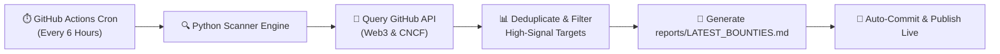

# 📡 Bounty Radar: Autonomous Web3 Bounty & CNCF Sentinel

An automated 24/7 cloud radar running on GitHub Actions that continuously monitors, scans, and triages:
1. **Web3 Protocol Bounties ($20 – $500+ USDC)** across verified DeFi and smart contract repositories.
2. **CNCF & Linux Foundation Open Issues** across graduated projects (`open-telemetry`, `kubernetes`, `jaegertracing`, `kyverno`) for LFX Mentorship Term 1 & GSoC.

---

### 📊 Quick Radar Snapshot
- **Last Scan Completed:** `2026-11-20 05:38:27 UTC`
- **Active Web3 Bounties Tracked:** `15`
- **Active CNCF Openings Tracked:** `20`
- **Full Live Dossier:** 👉 **[View Latest Bounty Report](reports/LATEST_BOUNTIES.md)**

---

### ⚙️ How It Works

---

*Maintained by [@givemehat](https://github.com/givemehat) · B.Tech CSE, Gautam Buddha University.*
